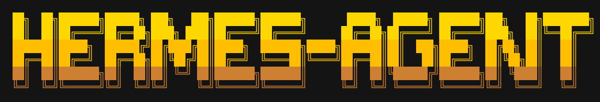

<<<<<<< HEAD
# Hermes Figma Prompt Hub - Complete Platform

> Design System & Prompt Management Platform with Figma Integration

[](https://opensource.org/licenses/MIT)
[](https://github.com/jozrftamson/hermes-figma-prompt-hub-nuxt/actions)

## 🎯 Features

### 📊 Core Features
- ✅ **Figma Integration** — Import PROMPT/* frames directly from Figma
- ✅ **Design System** — Complete CSS/SCSS generation from design tokens
- ✅ **Validation Suite** — Schema, layer contract, and quality checks
- ✅ **Prompt Management** — Create, edit, validate, and version prompts
- ✅ **Auto-Sync** — Webhook-based auto-sync from Figma changes
- ✅ **Web UI** — Nuxt 3 dashboard for prompt management

### 🎨 Design System
- **Colors** — Primary, Secondary, Semantic, Neutral palettes with shades
- **Typography** — 8-level font scale with weights and line-heights
- **Spacing** — 24-step spacing system (4px base)
- **Radius** — 9-level border radius scale
- **Shadows** — 5-level elevation system
- **Responsive** — Mobile-first 12-column grid with breakpoints

### 🤖 Prompt Strategies
- **Chain-of-Thought** — Structured step-by-step reasoning
- **Few-Shot Learning** — Pattern recognition with examples
- **Role-Play Persona** — Expert advice from specific roles
- **Tree-of-Thought** — Multiple parallel solution paths
- **Meta-Reasoning** — Self-validation and reflection

### ✅ Validation
- **Schema Validator** — JSON schema compliance
- **Layer Contract** — Figma structure validation
- **Content Quality** — Clarity, specificity, token estimation
- **Strategy-Specific** — Rules per prompting strategy

### 🔄 Integration
- **Figma API** — Direct import from Figma files
- **Webhooks** — Auto-sync on file changes
- **GitHub** — Native git integration
- **CI/CD** — GitHub Actions workflows

## 📦 Project Structure

```
hermes-figma-prompt-hub-nuxt/
├── pages/                    # Nuxt pages
│   ├── index.vue            # Dashboard
│   └── prompts/
│       ├── index.vue        # Prompts list
│       └── [id].vue         # Prompt detail
├── components/              # Vue components
├── stores/                   # Pinia stores
├── server/
│   ├── api/                 # Nuxt API routes
│   └── middleware/          # Server middleware
├── scripts/                 # Python & Bash scripts
│   ├── figma_importer.py    # Figma API client
│   ├── figma_webhook.py     # Webhook handler
│   ├── schema_validator.py  # Validation
│   ├── css_generator.py     # CSS generation
│   └── figma_sync.sh        # CLI orchestrator
├── data/                    # Design system JSON
│   ├── figma_design_system_extended.json
│   └── integration_guide.json
├── css/                     # Generated CSS
├── scss/                    # Generated SCSS
└── docs/                    # Documentation
```

## 🚀 Quick Start

### Prerequisites
- Node.js 18+
- Python 3.10+
- Git


## 📚 Documentation

- [Figma Integration Guide](./docs/FIGMA_INTEGRATION_GUIDE.md) — Setup Figma API
- [CSS/SCSS Guide](./docs/CSS_SCSS_GUIDE.md) — Generate styles
- [Validation Guide](./docs/VALIDATION_GUIDE.md) — Validate prompts
- [API Reference](./docs/API_REFERENCE.md) — API endpoints

## 🔗 API Endpoints

### Prompts
- `GET /api/prompts` — List all prompts
- `POST /api/prompts` — Create prompt
- `GET /api/prompts/:id` — Get prompt detail
- `PUT /api/prompts/:id` — Update prompt
- `DELETE /api/prompts/:id` — Delete prompt

### Figma Integration
- `POST /api/figma/sync` — Trigger sync from Figma
- `POST /api/figma/import` — Import prompts
- `GET /api/figma/status` — Check sync status

## 🔧 Scripts

### Figma Operations
```bash
./scripts/figma_sync.sh import          # Import from Figma
./scripts/figma_sync.sh validate        # Validate prompts
./scripts/figma_sync.sh webhook-setup   # Setup webhook
./scripts/figma_sync.sh sync            # Watch mode
```


## 🤝 Contributing

Contributions welcome! See [CONTRIBUTING.md](./CONTRIBUTING.md)

## 📝 License

MIT © 2025 Hermes Figma Prompt Hub

## 🔗 Links

- [Figma API Docs](https://www.figma.com/developers/api)
- [Nuxt 3](https://nuxt.com)
- [Pinia](https://pinia.vuejs.org)
**Built with ❤️ for prompt engineers and design systems teams**

## 📋 Figma Layer Contract

The importer expects Figma PROMPT frames with the following layer structure:

=======
<p align="center">
  
</p>
